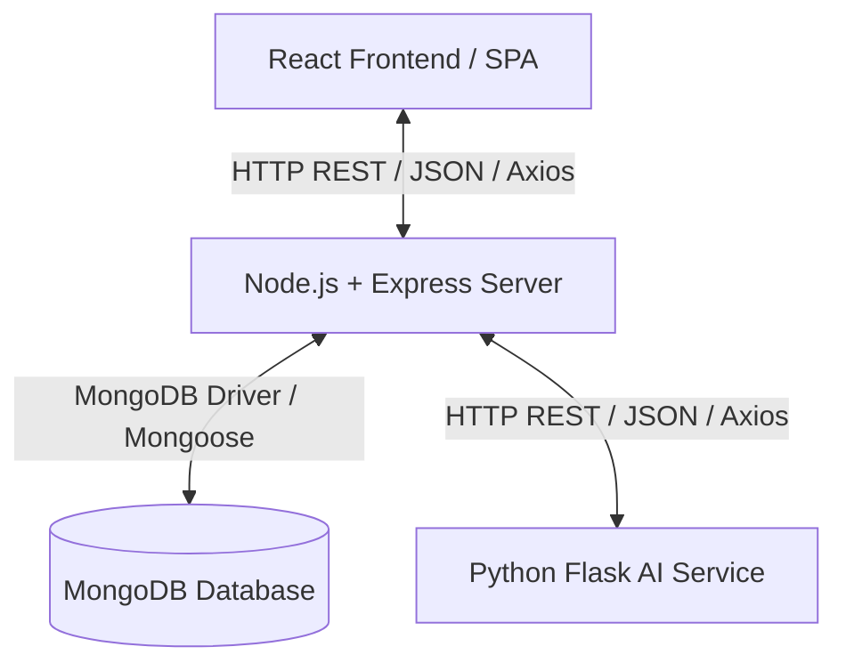

# Hackflow.ai - Comprehensive Project Guidebook & Interview Prep Manual

This guidebook serves as a complete technical reference manual for **Hackflow.ai**, a premium, multi-round hackathon management platform equipped with a hybrid human-AI evaluation engine and a state-of-the-art interactive 3D frontend. 

Use this manual to study the system architecture, database design, API endpoints, scoring algorithms, and potential technical interview questions.

---

## 1. Executive Summary & Core Concept

**Hackflow.ai** is designed to streamline the lifecycle of hosting, participating in, and judging hackathons. Most hackathon platforms only support single-round submissions and rely entirely on human judges, which can lead to bias, slow turnaround times, and inconsistent scoring. 

### Key Value Propositions
*   **Multi-Round Architecture:** Organizers can configure multiple rounds (e.g., Round 1: Ideation, Round 2: Prototype, Round 3: Pitch) with custom weightings (e.g., 30% Round 1, 70% Round 2).
*   **Dynamic Submission Schemas:** Each round can have a completely customized submission form (e.g., asking for GitHub links, PDF slide decks, pitch videos, or custom text fields).
*   **Hybrid Evaluation Engine:** Combines evaluations from human judges (weighted, e.g., 70%) and automated machine learning assessments (weighted, e.g., 30%) to generate unbiased rankings.
*   **AI Submission Auditing:** Employs TF-IDF Vectorization, Cosine Similarity matching against ideal project archetypes, and Sentiment Analysis to grade and audit participant submissions, highlight risk flags (like missing links or short write-ups), and offer actionable improvement tips.

---

## 2. High-Level Architecture & Communication Flow

Hackflow.ai is built using a decoupled **Three-Tier Architecture**:



### Flow of Data during Submission & Evaluation
1.  **Submission:** A Participant submits their round project via the React Client. File uploads (e.g., presentations) are handled via Multer and streamed to Cloudinary, returning public URLs.
2.  **AI Analysis Trigger:** The Express Server intercepts the submission, compiles the text descriptions and URLs, and sends them to the Flask AI Service via `/analyze-submission`.
3.  **AI Engine Computation:** Flask runs the submission text through pre-trained TF-IDF vectorizers, calculates similarity against Ideal Archetypes, performs sentiment analysis on the pitch notes, and calculates preliminary scores.
4.  **Database Persistence:** The AI-generated scores, feedback, strengths, weaknesses, and risk flags are stored directly in the `Submission` document in MongoDB.
5.  **Judge Evaluation:** A designated Judge logs in, views the submission (alongside the AI's feedback panel), and enters their marks across configured criteria (stored in the `Evaluation` document).
6.  **Leaderboard Compilation:** When requested, the server combines the average judge scores and AI scores using the round's configured weights, applies round-specific weightings, computes final scores, and stores a timestamped `LeaderboardSnapshot` for instant retrieval.

---

## 3. Technical Stack Breakdown

### Frontend (Client)
*   **Build Tool & Runtime:** Vite + React (v19)
*   **Routing:** React Router v7 (supports protected routes, nested routes, and URL parameter mapping)
*   **Styling:** Tailwind CSS (v4) for layouts, dark mode aesthetics, and glassmorphism UI variables.
*   **Animations:** GSAP (GreenSock) for complex scroll-driven visual sequences, Framer Motion for UI state transitions and hover interactions.
*   **3D Graphics:** React Three Fiber (R3F) & @react-three/drei (Three.js wrappers) to render the interactive background scenes, particle networks, and node charts.
*   **State Management:** React Context API (`AuthContext`) managing global user authentication state, local storage tokens, and automatic session restoration.

### Backend (Server)
*   **Runtime Environment:** Node.js (v18+)
*   **Framework:** Express (ES6 Modules configured with `"type": "module"`)
*   **Database:** MongoDB via Mongoose ODM
*   **File Storage:** Multer (multipart form handling) + Multer Storage Cloudinary (for direct image/PDF/video uploads)
*   **Authentication:** JSON Web Tokens (JWT) + Google Auth Library (for Google OAuth 2.0 verification)
*   **Security & Utilities:** Bcryptjs (password hashing), Nodemailer (OTP delivery for email verification), Cors.

### AI Service (Flask Machine Learning)
*   **Framework:** Flask (Python)
*   **Text Processing:** NLTK (Natural Language Toolkit) with VADER (Valence Aware Dictionary and sEntiment Reasoner) Lexicon for Sentiment Intensity Analysis.
*   **Feature Extraction:** Scikit-Learn's `TfidfVectorizer` for translating raw text into Vector Space models.
*   **Similarity Metric:** Cosine Similarity via Scikit-Learn to compare submission vectors against ideal archetypes.

---

## 4. Deep-Dive Database Schema & Data Models

### User Schema (`User.js`)
Stores identities and attributes for all platform members.
*   `name` (String): Display name of the user.
*   `email` (String, Unique): User email, verified via OTP.
*   `password` (String, Select: false): Hashed password (omitted from normal queries for security).
*   `googleId` (String, Sparse): Google user ID for SSO.
*   `role` (String, Enum): `organizer`, `judge`, or `participant`.
*   `collegeName`, `course`, `yearOfStudy`, `phone`, `skills` (Array), `githubUrl`, `linkedinUrl`, `resumeUrl`, `avatar` (String): Participant-specific profile data.
*   `isEmailVerified` (Boolean): Flag representing if email OTP verification was successful.
*   `emailVerificationToken` / `emailVerificationExpire`: Temporary credentials for OTP validation.

### Hackathon Schema (`Hackathon.js`)
Configures the parameters, timeline, participant pools, and evaluation rounds.
*   `title`, `description`, `theme`, `difficulty` (Enum): General details.
*   `startDate`, `endDate` (Dates): Event lifespan.
*   `createdBy` / `organizer` (Refs): References to the `User` document of the hosting organizer.
*   `students` (Array of Refs): References to registered participants.
*   `judges` (Array of Refs): References to judges invited to the hackathon.
*   `rounds` (Subdocument Array):
    *   `name`, `description`, `order` (Number): Round identifiers.
    *   `maxScore`, `weightagePercent` (Numbers): Contribution of the round to the global score.
    *   `status` (Enum): `draft`, `open`, `submission_closed`, `judging`, `published`.
    *   `scoringMode` (Enum): `hybrid`, `ai_only`, `judge_only`.
    *   `aiWeight` / `judgeWeight` (Numbers): The distribution percentages of scoring (must sum to 1.0).
    *   `submissionSchema` (Array): Dynamic form fields. Example:
        ```json
        { "fieldKey": "githubUrl", "label": "GitHub Link", "type": "github", "required": true }
        ```
    *   `criteria` (Subdocument Array): Marks breakdown, e.g., Innovation (30 marks), Code Quality (40 marks).

### Team Schema (`Team.js`)
Groups participants together for collaborative submissions.
*   `name` (String): Unique team name.
*   `teamCode` (String, Unique): 6-character alphanumeric code for invite matching (e.g., `AB12CD`).
*   `leader` (Ref): Reference to the `User` who created the team.
*   `members` (Array of Refs): References to all accepted team members.
*   `hackathon` (Ref): Reference to the `Hackathon` being entered.

### Submission Schema (`Submission.js`)
Represents the deliverables uploaded by a team for a specific round.
*   `hackathon` / `team` / `submittedBy` (Refs): Linkage details.
*   `roundIndex` (Number) / `roundName` (String): References which round this submission belongs to.
*   `pptUrl`, `documentUrl`, `githubUrl`, `demoVideoUrl`, `notesText`: Standard fields.
*   `submissionData` (Mixed): Catch-all object for custom forms configured in `submissionSchema`.
*   `isLocked` (Boolean): Prevents modification post-deadline or during judging.
*   `isLate` (Boolean): Calculated automatically if submitted past the round deadline.
*   `aiScore` (Object): Stored payload returned from Flask (raw scores, criteria breakdown, tips).
*   `judgeScore` (Object): Cached totals for optimization.

### Evaluation Schema (`Evaluation.js`)
Captures a single judge's scoring of a team's submission.
*   `submission` / `hackathon` / `judge` (Refs): Standard relationships.
*   `roundIndex` (Number): The round index being evaluated.
*   `scores` (Subdocument Array):
    *   `criteriaId` (Ref): Links back to the hackathon round criterion.
    *   `criteriaTitle`, `maxMarks`, `givenMarks`, `comment`
*   `judgeTotal` (Number): Sum of `givenMarks`.
*   `aiTotal` (Number): Copy of AI's raw score for hybrid calculation.
*   `finalTotal` (Number): Weighted combination of `judgeTotal` and `aiTotal` for this evaluator.
*   `weightedScore` (Number): Score adjusted for round weightage.
*   **Enforcement Index:** A compound unique index `submission: 1, judge: 1` ensures a judge can evaluate a specific submission only once.

### LeaderboardSnapshot Schema (`LeaderboardSnapshot.js`)
Stores a point-in-time calculation of rankings to avoid recalculating heavy queries on page refreshes.
*   `hackathon` (Ref): Target hackathon.
*   `generatedAt` (Date): Time of snapshot.
*   `rows` (Array of objects containing: `team` info, `roundScores` breakdown array, `totalScore`, and `rank`).

---

## 5. The Hybrid Scoring & AI Evaluation Engine (Technical Walkthrough)

One of the most complex parts of the system is the scoring mechanism. Let's break it down into the AI Service and the backend consolidation.

### A. The Flask AI Service (`ai-service/main.py`)

The Flask service evaluates submission text (notes + extracted metadata) relative to three ideal archetypes:

1.  **Innovation Archetype:** Evaluates the novelty, out-of-the-box thinking, and use of modern technologies (AI, blockchain).
2.  **Technical Archetype:** Evaluates architecture descriptions, microservices, scalability, low latency, clean code, and cloud stack details.
3.  **Business Archetype:** Evaluates business models, target audience, monetization strategies, feasibility, and ROI.

#### Scoring Algorithm Steps:
*   **TF-IDF Vectorization:**
    ```python
    vectorizer = TfidfVectorizer(stop_words='english')
    # Train the vectorizer on the three ideal archetypes
    tfidf_matrix_archetypes = vectorizer.fit_transform([IDEAL_INNOVATION, IDEAL_TECHNICAL, IDEAL_BUSINESS])
    ```
*   **Cosine Similarity calculation:**
    When a submission is received, it is vectorized and compared:
    ```python
    submission_vector = vectorizer.transform([combined_text])
    similarities = cosine_similarity(submission_vector, tfidf_matrix_archetypes)
    # similarities shape: [[innovation_sim, technical_sim, business_sim]]
    ```
*   **Scaling:**
    Cosine similarity scores in vector space models for short text are usually low (e.g., 0.1 to 0.3). The service scales these up to represent human-readable match percentages:
    ```python
    scaled_score = min(similarity_score * 4.0, 1.0) # Normalizes to range [0, 1]
    ```
*   **Sentiment Analysis Adjustment:**
    The VADER analyzer scores the tone of the description. If the sentiment score is highly positive (`compound > 0.5`), indicating an enthusiastic, well-pitched concept, a **5% boost** is applied:
    ```python
    if sentiment_score > 0.5:
        c_score = min(c_score * 1.05, c_max)
    ```
*   **GitHub Bonus:**
    If the criterion is technical and a GitHub URL is supplied, a **20% bonus** is added to the technical alignment score.

### B. Mongoose Fallback Heuristics (`aiEvaluationService.js`)
If the Flask service is down or timeouts occur, the Node.js server gracefully falls back to local regex matching and text lengths to prevent system blockage:
*   **Conceptual Criteria:** Points awarded proportionally to description length (e.g., >500 chars gets 100%, >200 chars gets 70%).
*   **Technical Criteria:** Points awarded based on the presence of a `githubUrl` field.
*   **Demo Criteria:** Points awarded based on the presence of a `demoVideoUrl` or `pptUrl`.

### C. Consolidating the Leaderboard (`leaderboardService.js`)
For each round, the combined score is computed as follows:

$$\text{Final Round Score} = (\text{Average Judge Score} \times \text{Judge Weight}) + (\text{AI Score} \times \text{AI Weight})$$

If the round weightage is $W\%$, the contribution of this round to the total leaderboard score is:

$$\text{Weighted Round Score} = \frac{\text{Final Round Score} \times W}{100}$$

$$\text{Total Leaderboard Score} = \sum \text{Weighted Round Score for all rounds}$$

---

## 6. API Reference Sheet

| Endpoint | Method | Middleware / Auth | Description |
| :--- | :--- | :--- | :--- |
| `/api/auth/register` | POST | Public | Register new user. Triggers OTP email. |
| `/api/auth/verify-email` | POST | Public | Validates OTP token, activates account, and returns JWT. |
| `/api/auth/login` | POST | Public | Authenticates credentials and returns JWT. |
| `/api/auth/google` | POST | Public | Google SSO integration verification. |
| `/api/auth/me` | GET | `protect` | Retrieves current user profile from token context. |
| `/api/hackathons` | GET | Public | Lists all active hackathons. Supports search/filter. |
| `/api/hackathons/:id` | GET | Public | Fetches detailed view of a specific hackathon. |
| `/api/hackathons` | POST | `protect`, `organizer` | Creates a new hackathon with custom rounds. |
| `/api/teams/create` | POST | `protect`, `participant`| Generates a new team and outputs `teamCode`. |
| `/api/teams/join` | POST | `protect`, `participant`| Joins a team using a 6-digit `teamCode`. |
| `/api/submissions` | POST | `protect`, `upload` | Submits project deliverables for a specific round. |
| `/api/evaluations` | POST | `protect`, `judge` | Submits a judge's criteria scoring. |
| `/api/leaderboard/:hackathonId`| GET | `protect` | Triggers calculation and fetches latest snapshot. |

---

## 7. Frontend Architecture, State Management, and 3D Visuals

### A. State Management: The `AuthContext`
The React application coordinates state using a global context provider:
*   On boot, `useEffect` reads a token from `localStorage`.
*   If found, it queries `/api/auth/me`. If valid, it hydrates the global user object. If expired, it wipes the token and routes the user to `/login`.
*   Includes hooks for `login`, `register`, `logout`, and `googleLogin`.

### B. Route Protection (`ProtectedRoute.jsx`)
Ensures that restricted pages (such as dashboards, submission forms, and evaluations) are blocked to unauthorized users:
*   Checks if the user context is loaded.
*   Redirects unauthenticated users to `/login`.
*   Can be parameterized to check for role authorization (e.g., preventing a participant from entering the `/dashboard/organizer` route).

### C. 3D Elements & Animations
*   **Hero Scene:** Displays a floating 3D core (`AICore.jsx`) with glowing particle lines (`ParticleField.jsx`) orbiting around it. It utilizes `@react-three/fiber` to bind animation frames to mouse movements, creating a Parallax shifting depth effect.
*   **Scroll Interactions:** GSAP anchors 3D rotation and element scale to scroll position (scroll trigger). As the user scrolls down, the 3D core morphs or scales down to reveal dashboard cards.

---

## 8. Edge Cases, Failure Handling, and Security Practices

### A. Race Conditions in Team Formation
*   **Issue:** What if a participant registers for multiple teams in the same hackathon?
*   **Prevention:** The `/api/teams/create` and `/api/teams/join` routes perform verification queries:
    ```javascript
    const existingTeam = await Team.findOne({ hackathon, members: userId });
    if (existingTeam) throw new Error("You are already registered in a team for this hackathon.");
    ```

### B. AI Service Outages & Network Delays
*   **Issue:** If the Python Flask API crashes, the submit button could freeze or fail.
*   **Prevention:** Axios configurations are set with standard timeouts, and the call is wrapped in a `try...catch` block. If it fails, the server prints a warning and invokes the **Local Heuristics Fallback** in `aiEvaluationService.js` to ensure the submission goes through smoothly.

### C. JWT Session Hijacking
*   **Issue:** Token exposure.
*   **Prevention:** Short token lifespans (e.g., 24h) combined with secure storage. All protected routes on the backend check the `Authorization` header containing the Bearer token, decoded using a secure `process.env.JWT_SECRET` value.

### D. File Upload Attacks
*   **Issue:** Uploading malicious executables (.exe) instead of presentations.
*   **Prevention:** Multer is configured to validate file extensions and limits file sizes (e.g., max 10MB). Files are streamed directly to Cloudinary, ensuring the server doesn't store volatile code.

---

## 9. Predictable Interview Questions & Model Answers

### Category 1: System & General Architecture

**Q1: Why did you decide to separate the Express Server and the Python Flask AI Service instead of putting everything into a single Node.js backend?**
> * **Answer:** This decision is based on **separation of concerns** and **resource utilization**. Node.js is excellent for asynchronous, I/O-heavy workloads (like database queries, API routing, and web requests) due to its event-driven single-threaded nature. However, CPU-bound tasks like vectorization, matrix calculations, and natural language sentiment analysis can block the Node.js event loop, degrading API response times. Python has a rich, highly optimized ecosystem for ML (Scikit-Learn, NumPy, NLTK). Running Flask as a microservice allows us to scale it independently (e.g., deploying the AI service on GPU-enabled instances if needed) without impacting the core web API.

**Q2: How does your application ensure that evaluations remain fair and unbiased? Describe the hybrid scoring logic.**
> * **Answer:** We implemented a configurable **Hybrid Evaluation Engine**. Organizers can allocate custom weights to human judges (e.g., 70%) and AI evaluation (e.g., 30%) on a per-round basis. The AI grades alignment mathematically using TF-IDF matching against pre-configured criteria, checking objective elements (like GitHub repositories and length of documentation) and running sentiment analysis to adjust scores. By combining this objective, mathematical baseline with the subjective experience of human judges, we reduce bias and ensure a consistent standard of grading.

---

### Category 2: Backend & Database Schema

**Q3: Looking at your `Evaluation` schema, you have a compound index on `submission` and `judge`. What is the purpose of this index?**
> * **Answer:** The compound index is: `evaluationSchema.index({ submission: 1, judge: 1 }, { unique: true })`. Its primary purpose is to enforce database-level integrity, preventing a judge from submitting multiple separate evaluations for the same project submission. If a judge accidentally double-clicks submit or sends duplicate API calls, MongoDB will throw a duplicate key error (`11000`), allowing us to catch the exception and prevent duplicate score calculations.

**Q4: How did you implement the "one team per participant per hackathon" constraint?**
> * **Answer:** Enforcing this constraint purely through standard MongoDB schema indexes is complex because team members are stored inside a nested array (`members`) in the `Team` collection. To solve this, we enforce it in the controller logic of both team creation and joining. Before adding a member to a team, we perform a query: `Team.findOne({ hackathon: hackathonId, $or: [{ leader: userId }, { members: userId }] })`. If a team is found, the registration is rejected.

---

### Category 3: Frontend & 3D Integration

**Q5: What is React Three Fiber (R3F) and how did you manage its performance on lower-end devices?**
> * **Answer:** React Three Fiber is a React wrapper for Three.js that allows us to build 3D scenes declaratively using JSX. Since WebGL rendering can be CPU and GPU intensive, we optimized performance by:
> 1. Restricting particle counts in our `ParticleField.jsx` (e.g., to 1000 nodes instead of tens of thousands).
> 2. Using `requestAnimationFrame` animations inside R3F's `useFrame` hook to perform math calculations instead of trigger-heavy React state refreshes, which prevents expensive DOM re-renders.
> 3. Wrapping the 3D canvases in React `Suspense` blocks to load assets asynchronously and prevent thread blockages during initial paint.

**Q6: How does the application handle authentication states and token expiry on the frontend?**
> * **Answer:** We use a global `AuthContext` that wraps our application hierarchy. When the app boots, the context checks `localStorage` for a JWT token. If found, it decodes the token using `jwt-decode` to verify expiration (`decoded.exp * 1000 < Date.now()`). If the token is valid, it makes an API call to `/api/auth/me` to fetch current user data and hydrates the React state. If the token is expired or the backend returns an error, the client clears the token and automatically redirects the user to `/login` via protected route gates.

---

### Category 4: Machine Learning & NLP

**Q7: Explain how Cosine Similarity and TF-IDF work in your AI scoring model.**
> * **Answer:** 
> * **TF-IDF (Term Frequency-Inverse Document Frequency):** Converts raw text into numerical vectors. Term Frequency (TF) counts how often a term appears in a submission, while Inverse Document Frequency (IDF) penalizes common filler words (like "the", "is") and boosts rare, descriptive words. 
> * **Cosine Similarity:** Measures the cosine of the angle between the submission vector and our Ideal Archetype vectors (Innovation, Technical, Business). The value ranges from 0 to 1. A score close to 1 indicates that the vocabulary and keyword weights in the submission align closely with our benchmark profiles. We then scale these outputs to match the maximum marks allocated for the corresponding criteria.

**Q8: Why did you choose VADER Sentiment Analysis for adjusting scores?**
> * **Answer:** VADER is specifically optimized for short text pitches and parses sentiment intensity including capitalization (e.g., "GREAT" vs "great") and exclamation marks. We use it to gauge the developer's pitch enthusiasm. If a submission's compound sentiment score is highly positive (`> 0.5`), we award a slight booster (up to 5%) to criteria scores, reflecting the impact of a strong, confident written pitch.

---

## 10. Ultimate Interview Checklist

Before entering your interview tomorrow, make sure you can speak confidently about:
*   [ ] **JWT Payload Structure:** Explain that it contains the user `_id`, `role`, and token expiration time.
*   [ ] **Database Normalization:** Explain why we store evaluations in a separate collection (`Evaluation`) instead of nesting them in `Submission` (to avoid document size limitations and support faster concurrent updates by multiple judges).
*   [ ] **Cloudinary Integration:** Explain that file streams are handled by Multer in memory and pushed directly to Cloudinary to save server storage space.
*   [ ] **Local Heuristics Fallback:** Be prepared to highlight this as a defensive design pattern you created to handle third-party service downtime gracefully.
