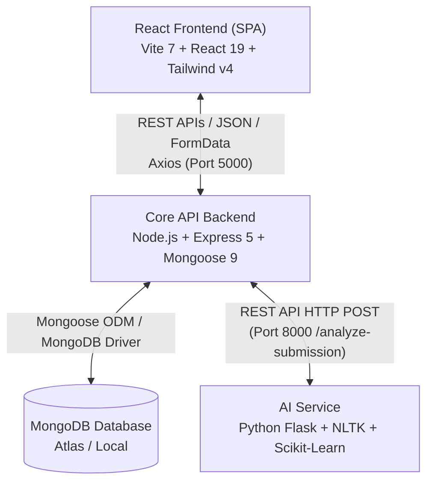
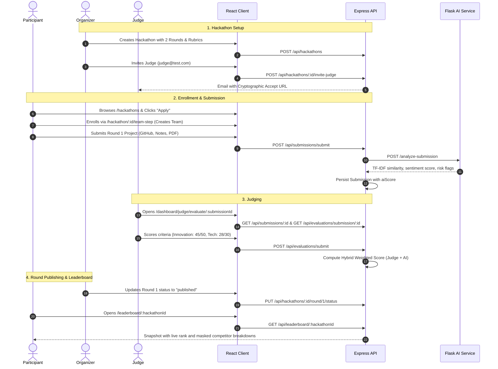
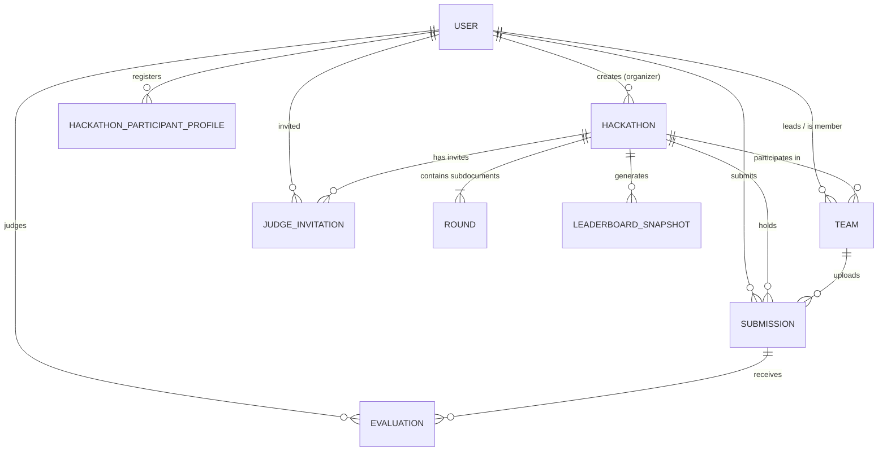

# Project Status — What Has Been Built So Far

**Audit Date:** October 2026  
**Auditor:** Senior Full-Stack Software Engineer & Code Reviewer  
**Repository:** `hackflowAI`  
**Workspace Path:** `c:\Users\Tushar Bansal\Desktop\Programming\hackflowAI`

---

## 1. Executive Summary & Project Purpose

**Hackflow.ai** is an end-to-end hackathon management and evaluation platform engineered to manage multi-round competitive hackathons. Traditional hackathon workflows suffer from chaotic submission handling (spreadsheets, Google Forms), single-round limitations, and subjective judging bias. 

### Intended Users & Roles
1. **Organizers:**
   - Create, configure, edit, and manage multi-round hackathons.
   - Configure custom scoring rubrics (criteria, max marks, round weightings).
   - Control round lifecycles (`draft`, `open`, `submission_closed`, `judging`, `published`) and auto-lock submissions.
   - Invite and assign judges to hackathons and specific rounds.
   - Inspect team enrollments, review submissions, and publish real-time leaderboards.
2. **Participants:**
   - Discover hackathons, view detailed timelines and round requirements.
   - Create or join collaborative teams (up to 4 members) using 6-character alphanumeric invite codes.
   - Complete required participant qualification profiles (college, course, year, contact, GitHub/LinkedIn/resume).
   - Submit project deliverables per round (GitHub URL, demo video, presentation decks, documentation, or dynamic form fields).
   - Track round progress, automated submission audit flags, and published round scores.
3. **Judges:**
   - Accept email-based judge invitations via secure cryptographic tokens.
   - View assigned hackathons and pending submission review queues.
   - Inspect participant submissions alongside automated AI audit insights (sentiment analysis, strengths, weaknesses, risk flags).
   - Score submissions against criteria rubrics using interactive score sliders and written feedback.

---

## 2. Technology Stack & Architecture

Hackflow.ai is architected as a **decoupled three-tier microservice architecture**:



### Stack Breakdown

| Component | Technology | Version | Purpose & Responsibilities |
| :--- | :--- | :--- | :--- |
| **Frontend** | React | `19.2.0` | Component-based UI library |
| | Vite | `7.2.4` | Development server and asset bundler |
| | React Router DOM | `7.13.0` | Client-side routing, protected routes, URL parameters |
| | Tailwind CSS | `4.1.18` (PostCSS) | Utility-first CSS engine using modern `@theme` variables |
| | Framer Motion | `12.33.0` | Declarative UI animations and transitions |
| | GSAP | `3.14.2` | Scroll animations, parallax cards, stagger grids |
| | Lucide React | `0.563.0` | Modern SVG iconography |
| | Recharts | `3.7.0` | Interactive dashboard charts (Area, Pie, Bar charts) |
| | Three.js / R3F | `0.182.0` / `9.5.0` | WebGL 3D graphics (dependencies installed, unmounted in UI) |
| | Axios | `1.13.4` | HTTP client communicating with Node backend |
| **Backend** | Node.js | `>=18.0.0` (Active: `v24.12.0`) | JavaScript runtime |
| | Express | `5.2.1` | REST API framework (`"type": "module"`) |
| | Mongoose | `9.1.6` | Object Data Modeling (ODM) for MongoDB |
| | JSON Web Tokens | `9.0.3` | User authentication and session tokens (`30d` expiry) |
| | Bcryptjs | `3.0.3` | Password hashing (salt rounds: 10) |
| | Multer | `2.0.2` | Multipart/form-data upload handler |
| | Multer Cloudinary | `4.0.0` | Direct streaming of uploads to Cloudinary storage |
| | Cloudinary | `1.41.3` | Cloud media asset hosting |
| | Nodemailer | `8.0.1` | Transactional email delivery (OTP verification, judge invites) |
| | Google Auth Library| `10.5.0` | Google OAuth 2.0 ID token verification |
| **AI Microservice**| Python | `>=3.10` (Active: `3.14.2`) | Microservice execution runtime |
| | Flask | `3.0.0` | Lightweight REST API server on port `8000` |
| | Scikit-Learn | `1.3.2` | TF-IDF vectorization and cosine similarity calculations |
| | NLTK | `3.8.1` | VADER sentiment analysis and word tokenization |
| | NumPy | `1.26.2` | Matrix operations |

---

## 3. Existing Folder & File Structure

```text
hackflowAI/
├── PROJECT_GUIDEBOOK.md          # Comprehensive architectural and interview guidebook
├── SEEDED_CREDENTIALS.md         # Demo account credentials for manual testing
├── ai-service/                   # Python Flask AI Evaluation Microservice
│   ├── experiment.ipynb          # Jupyter prototyping notebook for ML scoring
│   ├── main.py                   # Flask server endpoint (/analyze-submission)
│   ├── requirements.txt          # Python dependency specifications
│   └── test_service.py           # Manual HTTP test script for Flask endpoint
├── client/                       # React 19 + Vite 7 Frontend SPA
│   ├── .env                      # Local environment configuration
│   ├── .env.example              # Example environment template
│   ├── eslint.config.js          # ESLint 9 configuration
│   ├── index.html                # HTML entry point with meta tags and Google fonts
│   ├── package.json              # Client dependencies and npm scripts
│   ├── postcss.config.js         # PostCSS configuration (@tailwindcss/postcss)
│   ├── vite.config.js            # Vite configuration with React plugin
│   ├── vercel.json               # Vercel SPA routing rewrite rules
│   ├── public/                   # Static public assets
│   └── src/
│       ├── App.css               # Ancillary application styles
│       ├── App.jsx               # Main router and route declarations
│       ├── index.css             # Design tokens, color system, font definitions
│       ├── main.jsx              # DOM root mount with GoogleOAuthProvider
│       ├── api/
│       │   ├── config.js         # Axios instance and base URL configuration
│       │   └── hooks/            # [UNINTEGRATED] Custom React query hooks (6 files)
│       ├── components/
│       │   ├── 3d/               # [UNINTEGRATED] R3F 3D Canvas scenes and components (7 files)
│       │   ├── layout/           # Navbar, Footer, Page Layout shells
│       │   ├── sections/         # Hero, TrustedBy, PromoBanners
│       │   ├── three/            # [UNINTEGRATED] Alternative Three.js scene models (4 files)
│       │   ├── ui/               # 33 atomic UI design system components
│       │   ├── AIFeedbackPanel.jsx # AI scoring summary, tips, risks badge renderer
│       │   └── ProtectedRoute.jsx  # Route authorization gate
│       ├── context/
│       │   └── AuthContext.jsx   # Global auth state, JWT decode, login/logout handlers
│       ├── pages/                # Top-level route pages (12 files)
│       │   ├── dashboards/       # Specialized role dashboards & panels (12 files)
│       └── utils/
│           ├── fileUtils.js      # URL sanitation and Cloudinary absolute link resolvers
│           ├── parallaxEffects.js# GSAP card tilt and parallax handlers
│           ├── scrollAnimations.js # GSAP timeline animations
│           └── scrollReveal.js   # GSAP IntersectionObserver and reveal triggers
└── server/                       # Node.js + Express 5 Core API Server
    ├── .env                      # Server runtime environment variables
    ├── .env.example              # Sample environment template
    ├── package.json              # Server dependencies and npm scripts
    ├── server.js                 # Express server bootstrap, middleware, and route mounting
    └── src/
        ├── config/
        │   ├── cloudinary.js     # Cloudinary SDK and Multer storage engine
        │   └── db.js             # Mongoose MongoDB connection handler
        ├── controllers/          # 9 Business logic controllers
        ├── middleware/           # Auth, judge context, ownership guard, and upload middleware
        ├── models/               # 8 Mongoose data models
        ├── routes/               # 9 Express route definitions
        ├── services/             # Scoring, AI bridge, and leaderboard calculations
        └── utils/                # Transactional emailer and round status evaluator
```

---

## 4. Features Already Implemented

Based on direct inspection of the codebase, the following features have functional implementations:

1. **Email OTP Authentication Flow:**
   - Registration triggers random 6-digit OTP generation, hashed using PBKDF2 (`crypto.pbkdf2Sync`) with salt and stored in `User` document.
   - Nodemailer delivers verification emails (`authController.js:registerUser`).
   - OTP verification activates account and issues a 30-day JWT (`authController.js:verifyEmail`).
   - Support for resending OTPs with expiration checks (`authController.js:resendOtp`).
2. **Google OAuth 2.0 Integration:**
   - Google ID token verification via `google-auth-library` (`authController.js:googleLogin`).
   - Auto-creates user or links `googleId` to existing account.
3. **Role-Based Routing:**
   - `ProtectedRoute.jsx` intercepts unauthorized page requests.
   - Dynamic dashboard redirection (`Dashboard.jsx`) routes user to `OrganizerDashboard`, `JudgeDashboard`, or `ParticipantDashboard` based on `user.role`.
4. **Hackathon Browsing, Filtering & Pagination:**
   - Full search by title/description, filters by theme/difficulty/status (active, upcoming, past based on server date), and sorting (`hackathonController.js:getHackathons`).
   - Debounced frontend search and pagination controls (`Hackathons.jsx`).
5. **Multi-Round Hackathon Creation:**
   - Organizers can configure rounds, criteria rubrics with individual mark allocations, weightings (validated to sum to 100%), auto-time control flags, and dynamic form schemas (`CreateHackathon.jsx`, `hackathonController.js:createHackathon`).
6. **Judge Invitations via Cryptographic Tokens:**
   - Organizers invite judges by email. A SHA-256 hashed invite token is stored with a 48-hour expiration (`JudgeInvitation.js`).
   - Email invitation link routes to `JudgeInviteAccept.jsx` (`hackathonController.js:inviteJudge`).
7. **Team Formation & Constraints:**
   - Teams are capped at 4 members.
   - Controller-level constraint enforcement prevents participants from joining or creating multiple teams for the same hackathon (`teamController.js:createTeam`, `teamController.js:joinTeamByCode`).
   - Alphanumeric 6-character team codes are automatically generated.
8. **Participant Profile Enforcement:**
   - Participants must complete a hackathon profile before submitting deliverables (`HackathonParticipantProfile.js`).
   - Auto-syncs from global profile (`User.js`) or previous hackathons (`participationController.js`).
9. **Automated Submission AI Auditing & Fallback:**
   - When a submission is posted, the server triggers an asynchronous call to the Flask AI service (`aiEvaluationService.js:analyzeSubmission`).
   - Flask microservice computes TF-IDF Cosine Similarity against ideal archetypes (Innovation, Technical, Business), runs NLTK VADER sentiment analysis, grants GitHub bonuses, and outputs risk flags (`ai-service/main.py`).
   - If the AI microservice fails or is unreachable, the Node.js server seamlessly invokes **local regex/length heuristics** to score the submission without blocking the user.
10. **Multi-Round Submission Auto-Locking:**
    - Transitioning a round status to `submission_closed`, `judging`, or `published` automatically locks all team submissions for that round (`hackathonController.js:updateRoundStatus`).
11. **Live Leaderboard Generation & Public Masking:**
    - Generates point-in-time leaderboard snapshots (`LeaderboardSnapshot.js`) sorted by weighted total score.
    - Masks detailed scoring breakdowns of competitors from participants while granting full visibility to organizers/judges (`leaderboardController.js:getLeaderboard`).

---

## 5. Features That Appear Partially Implemented or Incomplete

1. **Dynamic Submission Schema Rendering vs Upload Middleware:**
   - `Hackathon.js` and `CreateHackathon.jsx` allow arbitrary field definitions (`file`, `ppt`, `video`, `text`, etc.).
   - However, `submissionRoutes.js` hardcodes Multer to accept only `ppt` and `document`. Any dynamic file key causes upload failure.
2. **Judge Dashboard Review Queue:**
   - In `hackathonController.js:getJudgeStats`, the `completedReviews` count is hardcoded to `0` with developer notes stating it is a placeholder until deep linking with `Evaluation` is done.
   - In `JudgeDashboard.jsx`, the review list hardcodes `"5 Pending"` and `"pending"` status chips.
3. **Participant Dashboard Progress Metrics:**
   - `ParticipantDashboard.jsx` displays hardcoded progress indicators: `"85%"` Profile Completion, `"92%"` Hackathon Readiness, and `"Gold Member"` badge without underlying calculation.
4. **Shortlisting Service:**
   - `server/src/services/shortlistService.js` contains a stub function `shortlistTeams` that returns sliced snapshot rows without updating team states or connecting to any API route.
5. **Email Password Recovery:**
   - `Login.jsx` links to `/forgot-password`, but no route, page, or backend password-reset endpoint exists.
6. **Leaderboard Custom Round Weights:**
   - `leaderboardService.js` uses hardcoded `JUDGE_WEIGHT = 0.7` and `AI_WEIGHT = 0.3` instead of reading `round.judgeWeight` and `round.aiWeight` from the hackathon model.

---

## 6. Frontend Pages, Components, and User Flows

### Registered Application Routes (`App.jsx`)

| Route Path | Component | Auth Required | Intended Role | Purpose |
| :--- | :--- | :--- | :--- | :--- |
| `/` | `Landing.jsx` | Public | All | Hero section, value propositions, featured hackathons |
| `/login` | `Login.jsx` | Public | All | Email/password & Google OAuth login |
| `/register` | `Register.jsx` | Public | All | Registration with OTP trigger |
| `/verify-email` | `VerifyEmail.jsx`| Public | All | 6-digit OTP entry and email verification |
| `/judge-invite/accept` | `JudgeInviteAccept.jsx` | Private | Judge | Verifies token and binds judge to hackathon |
| `/hackathons` | `Hackathons.jsx`| Public | All | Search, filter, and paginate all hackathons |
| `/hackathon/:id` | `HackathonDetails.jsx` | Public | All | View hackathon rules, schedule, prizes, apply |
| `/profile` | `Profile.jsx` | Private | All | Edit personal bio, skills, college info, avatar |
| `/dashboard` | `Dashboard.jsx` | Private | All | Role-based router delegating to specific dashboard |
| `/dashboard/create-hackathon` | `CreateHackathon.jsx` | Private | Organizer | Multi-step hackathon creation wizard |
| `/dashboard/edit-hackathon/:id` | `CreateHackathon.jsx` | Private | Organizer | Edit hackathon configuration |
| `/dashboard/team` | `TeamPanel.jsx` | Private | Participant | Manage team, create team, join with code |
| `/dashboard/organizer/teams/:hackathonId` | `OrganizerTeams.jsx` | Private | Organizer | View enrolled teams and member rosters |
| `/dashboard/organizer/rounds/:hackathonId` | `OrganizerRounds.jsx`| Private | Organizer | Step-by-step round status transitions & locks |
| `/dashboard/organizer/judges/:hackathonId` | `OrganizerJudges.jsx`| Private | Organizer | Send judge invitations and remove judges |
| `/dashboard/submission` | `SubmissionPanel.jsx` | Private | Participant | General project submission panel |
| `/dashboard/organizer/submissions/:hackathonId` | `SubmissionReview.jsx` | Private | Organizer/Judge | Review submitted projects across rounds |
| `/dashboard/judge/evaluate/:submissionId` | `JudgeEvaluation.jsx` | Private | Judge | Detailed scoring slider rubric with AI feedback |
| `/leaderboard/:hackathonId` | `Leaderboard.jsx` | Private | All | Live weighted leaderboard rankings |
| `/hackathon/:id/team-step` | `TeamStep.jsx` | Private | Participant | Create or join team during hackathon onboarding |
| `/hackathon/:id/participant-form` | `ParticipantProfileForm.jsx` | Private | Participant | Hackathon-specific participant registration form |
| `/hackathon/:id/participation` | `Participation.jsx` | Private | Participant | Live participant timeline, round steps, scores |
| `/hackathon/:id/round/:roundIndex/submit` | `SubmissionPanel.jsx` | Private | Participant | Deep-linked round submission |
| `/hackathon/:id/round/:roundIndex/view` | `SubmissionPanel.jsx` | Private | Participant | Deep-linked view of submitted project |

### Primary User Flows


---

## 7. Backend APIs, Routes, Middleware, and Business Logic

The backend mounts 9 primary route modules under the `/api` prefix:

| Base Path | Module File | Key Endpoints | Protection / Guard |
| :--- | :--- | :--- | :--- |
| `/api/auth` | `authRoutes.js` | `POST /register`, `POST /login`, `POST /verify-email`, `POST /resend-otp`, `POST /google`, `GET /me`, `PUT /profile` | Public / `protect` |
| `/api/hackathons` | `hackathonRoutes.js` | `GET /`, `POST /`, `GET /:id`, `PUT /:id`, `DELETE /:id`, `GET /organizer/my`, `GET /judge/my`, `GET /stats/*`, `PUT /:id/round/:roundIndex/status`, `POST /:id/invite-judge`, `POST /accept-judge-invite` | `protect`, `authorize`, `organizerOwnershipGuard` |
| `/api/teams` | `teamRoutes.js` | `POST /create`, `POST /join`, `POST /leave`, `GET /my`, `GET /hackathon/:hackathonId`, `GET /my/by-hackathon/:hackathonId` | `protect`, `authorize('organizer')` |
| `/api/submissions` | `submissionRoutes.js` | `POST /submit`, `GET /my`, `GET /:id`, `GET /hackathon/:hackathonId/round/:roundIndex` | `protect`, `upload.fields`, `judgeHackathonGuard` |
| `/api/evaluations` | `evaluationRoutes.js` | `POST /submit`, `GET /submission/:submissionId`, `GET /:id` | `protect`, `judgeHackathonGuard` |
| `/api/leaderboard` | `leaderboardRoutes.js` | `GET /:hackathonId`, `POST /:hackathonId/refresh` | `protect` |
| `/api/participant-profile` | `participantProfileRoutes.js`| `POST /:hackathonId`, `GET /:hackathonId/status`, `GET /:hackathonId/me` | `protect`, `upload.single('resume')` |
| `/api/participation` | `participationRoutes.js` | `GET /:hackathonId/me` | `protect` |
| `/api/debug` | `debugRoutes.js` | `POST /run-ai/:submissionId` | `protect`, `authorize('organizer')` |
| `/api/health` | `server.js` | `GET /api/health` | Public |

### Middleware Architecture
1. `protect` (`authMiddleware.js`): Extracts Bearer JWT from `Authorization` header, decodes user ID, queries MongoDB, attaches `req.user`.
2. `authorize(...roles)` (`authMiddleware.js`): Checks `roles.includes(req.user.role)` and returns 403 Forbidden on mismatch.
3. `organizerOwnershipGuard` (`organizerOwnershipGuard.js`): Validates that the logged-in organizer is the `createdBy` owner of the target hackathon.
4. `judgeHackathonGuard` (`judgeMiddleware.js`): Validates that the caller has `role === 'judge'` and is in `hackathon.judges`.
5. `uploadMiddleware` (`uploadMiddleware.js`): Wraps Multer with Cloudinary storage and sets 10MB limits.

---

## 8. Database Schemas, Models, Relationships, and Data Flow

The database uses MongoDB with Mongoose ODM schemas:



### Models Summary
1. `User.js`: Identity, credentials, role (`organizer`, `judge`, `participant`), Google ID, global profile attributes, email verification tokens.
2. `Hackathon.js`: Title, dates, theme, difficulty, `createdBy`, `organizer`, `judges` array, `roundJudges` mapping, and embedded `rounds` array.
   - Subdocument `roundSchema`: Name, order, maxScore, weightagePercent, status, scoringMode (`hybrid`, `ai_only`, `judge_only`), aiWeight, judgeWeight, start/end dates, submissionSchema, and criteria array.
3. `Team.js`: Team name, unique 6-character alphanumeric `teamCode`, leader reference, members reference array, hackathon reference.
4. `Submission.js`: Hackathon reference, team reference, submittedBy reference, roundIndex, URLs (github, demoVideo, ppt, document), notesText, dynamic `submissionData` object, version, locks, `aiScore` payload, `judgeScore` cache.
5. `Evaluation.js`: Submission reference, hackathon reference, judge reference, roundIndex, criteria scores breakdown array, `judgeTotal`, `aiTotal`, `finalTotal`, `weightedScore`. Unique compound index on `{ submission: 1, judge: 1 }`.
6. `LeaderboardSnapshot.js`: Hackathon reference, generated timestamp, ranked team rows with round breakdown. Compound index on `{ hackathon: 1, generatedAt: -1 }`.
7. `HackathonParticipantProfile.js`: User reference, hackathon reference, education details, contact, resume URL. Unique compound index on `{ user: 1, hackathon: 1 }`.
8. `JudgeInvitation.js`: Hackathon reference, organizer reference, judge email, SHA-256 inviteToken, status (`pending`, `accepted`, `expired`), expiresAt.

---

## 9. Third-Party Integrations & External Services

| Service | Mechanism | Status & Purpose |
| :--- | :--- | :--- |
| **MongoDB Atlas** | Mongoose connection string (`MONGO_URI`) | Core persistence layer |
| **Cloudinary** | `cloudinary` + `multer-storage-cloudinary` | Direct file stream upload for avatars, slide decks, resumes, documents |
| **Google Identity (OAuth 2.0)** | `@react-oauth/google` + `google-auth-library` | One-click SSO authentication |
| **Nodemailer (SMTP)** | Standard SMTP transport (`SMTP_HOST`, `SMTP_PORT`, `SMTP_USER`, `SMTP_PASS`) | Sends OTP emails for verification and judge invitation links |
| **Flask AI Microservice** | Internal REST HTTP bridge (`AI_SERVICE_URL`) | Machine learning scoring engine via TF-IDF, Cosine Similarity, and NLTK VADER |

---

## 10. Existing Tests & Test Coverage

- **Automated Unit / Integration Tests:** **0% Coverage**.
  - `server/package.json` contains `"test": "echo \"Error: no test specified\" && exit 1"`.
  - `client/package.json` contains no test runner (no Vitest, Jest, Cypress, or Playwright).
  - `ai-service/test_service.py` is a manual integration script that executes only when a local Flask server is running on port 8000.
- **Syntax Verification Performed During Audit:**
  - `node --check` executed across all server JS files: **PASSED (0 syntax errors)**.
  - `python -m py_compile` executed across `ai-service/*.py`: **PASSED (0 syntax errors)**.

---

## 11. Current Setup & Execution Instructions

Based on repository evidence, running this application locally requires three separate terminal processes:

### Prerequisites
- Node.js `v18+` (Tested on `v24.12.0`)
- Python `3.10 - 3.12` recommended (Note: Python `3.14` has dependency compatibility issues with numpy `1.26.2`)
- MongoDB instance (Local or Atlas)
- Cloudinary Account & SMTP credentials (or test credentials)

### Step 1: Start AI Microservice
```bash
cd ai-service
# Recommended: Create virtual environment using Python 3.11 or 3.12
python -m venv venv
venv\Scripts\activate  # On Windows
pip install -r requirements.txt
python main.py
# Microservice listens on http://localhost:8000
```

### Step 2: Start Express Server
```bash
cd server
npm install
# Configure .env based on .env.example
npm run dev
# Server listens on http://localhost:5000
```

### Step 3: Start React Client
```bash
cd client
npm install
# Configure .env (VITE_API_BASE_URL=http://localhost:5000/api)
npm run dev
# Vite runs on http://localhost:5173
```

---

## 12. Implementation Summary Matrix

| Module / Capability | Implementation State | Verification Method | Notes & Known Gaps |
| :--- | :--- | :--- | :--- |
| **User Authentication (JWT + OTP)** | **Complete** | Code inspection | Fully implemented with cryptographic hashing and email delivery |
| **Google SSO Integration** | **Complete** | Code inspection | Backend verification with `google-auth-library` |
| **Hackathon CRUD** | **Complete** | Code inspection | Creation rubric validation (100% weight check) functional |
| **Judge Invitations** | **Complete** | Code inspection | Token generation, verification, and email dispatch operational |
| **Team Management** | **Complete** | Code inspection | 4-member limit and single-team-per-event check verified |
| **Participant Submissions** | **Partially Complete** | Code inspection | Dynamic schemas fail with static Multer config |
| **Judge Evaluations** | **Partially Complete** | Code inspection | Guard blocks organizers; stats endpoint has stubbed counts |
| **Hybrid Leaderboard Engine** | **Partially Complete** | Code inspection | Scoring logic double-dips AI score and ignores custom weights |
| **Organizer Dashboard** | **Broken** | Code inspection | Throws `ReferenceError: setHackathons is not defined` |
| **3D Graphics & Canvas** | **Not Implemented / Dead** | Code inspection | 11 3D scene files exist but are completely unmounted in the UI |
| **Password Reset Flow** | **Not Implemented** | Code inspection | Links to dead `/forgot-password` route |
| **Shortlist Teams Feature** | **Not Implemented** | Code inspection | `shortlistService.js` is an unused stub |
| **Automated Test Suite** | **Not Implemented** | Configuration check | Zero automated test coverage across all packages |
