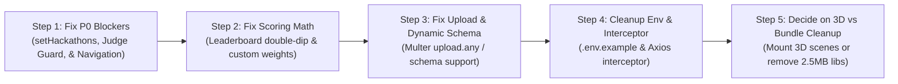

# Project Improvement Suggestions — What Can We Do Next?

**Audit Date:** October 2026  
**Auditor:** Senior Full-Stack Software Engineer & Code Reviewer  
**Repository:** `hackflowAI`  
**Workspace Path:** `c:\Users\Tushar Bansal\Desktop\Programming\hackflowAI`

---

## Overview

This document presents actionable, repository-specific improvement recommendations for **Hackflow.ai**. Every suggestion is grounded directly in findings from the active codebase. No generic advice is included. Items requiring product decisions from the project maintainer are explicitly marked with `[Requires Product Decision]`.

---

## 1. Quick Wins (< 1 Hour Each)

### QW-1: Fix Undeclared `setHackathons` in Organizer Dashboard
1. **Proposed Improvement:** Declare `const [hackathons, setHackathons] = useState([]);` in `OrganizerDashboard.jsx`.
2. **Why It Matters:** Currently, `OrganizerDashboard.jsx:45` calls `setHackathons(myHackathons)` which throws a `ReferenceError` at runtime, caught by `catch`, silently leaving the recent events table and status charts completely blank.
3. **Files Affected:** `client/src/pages/dashboards/OrganizerDashboard.jsx`
4. **Estimated Complexity:** Easy (5 minutes)
5. **Dependencies / Prerequisites:** None
6. **Expected Outcome:** Organizer dashboard immediately populates active hackathons, event cards, and pie charts correctly.
7. **Priority:** **P0**

### QW-2: Fix Broken Navigation Link in `OrganizerJudges.jsx`
1. **Proposed Improvement:** Change `navigate('/dashboard/organizer')` to `navigate('/dashboard')` on line 96 of `OrganizerJudges.jsx`.
2. **Why It Matters:** React Router has no route for `/dashboard/organizer`. Clicking "Back to Dashboard" renders a blank screen / 404.
3. **Files Affected:** `client/src/pages/dashboards/OrganizerJudges.jsx`
4. **Estimated Complexity:** Easy (2 minutes)
5. **Dependencies / Prerequisites:** None
6. **Expected Outcome:** Smooth return navigation to the organizer console.
7. **Priority:** **P0**

### QW-3: Fix Debug Controller `totalScore` NaN Bug
1. **Proposed Improvement:** In `server/src/controllers/debugController.js:38`, change `curr.totalScore` to `curr.judgeTotal` (or `curr.finalTotal`).
2. **Why It Matters:** `curr.totalScore` is `undefined` on the `Evaluation` model, reducing the sum to `NaN` and causing the debug AI evaluation endpoint to output `finalScore: NaN`.
3. **Files Affected:** `server/src/controllers/debugController.js`
4. **Estimated Complexity:** Easy (5 minutes)
5. **Dependencies / Prerequisites:** None
6. **Expected Outcome:** `/api/debug/run-ai/:submissionId` returns valid mathematical scores.
7. **Priority:** **P1**

### QW-4: Fix Hardcoded Client API URL in `JudgeInviteAccept.jsx`
1. **Proposed Improvement:** Replace direct `axios.post(`${import.meta.env.VITE_API_BASE_URL}/api/...`)` with the central `api.post('/hackathons/accept-judge-invite', { token })` instance.
2. **Why It Matters:** Prevents accidental double `/api/api` prefixing and honors standard base URL configuration.
3. **Files Affected:** `client/src/pages/JudgeInviteAccept.jsx`
4. **Estimated Complexity:** Easy (5 minutes)
5. **Dependencies / Prerequisites:** None
6. **Expected Outcome:** Judge invitation acceptance functions consistently in local and deployed environments.
7. **Priority:** **P1**

### QW-5: Add Missing Environment Variables to `.env.example`
1. **Proposed Improvement:** Document all 12 active environment variables in `server/.env.example` (adding `FRONTEND_URL`, `CLIENT_URL`, `GOOGLE_CLIENT_ID`, `SMTP_*`, `CLOUDINARY_*`, `AI_SERVICE_URL`) and `VITE_GOOGLE_CLIENT_ID` in `client/.env.example`.
2. **Why It Matters:** New team members or CI/CD pipelines cannot run the backend or frontend without guessing missing keys.
3. **Files Affected:** `server/.env.example`, `client/.env.example`
4. **Estimated Complexity:** Easy (10 minutes)
5. **Dependencies / Prerequisites:** None
6. **Expected Outcome:** Complete, frictionless onboarding configuration.
7. **Priority:** **P1**

---

## 2. Important Functional Improvements

### FN-1: Allow Organizers to Access Submission Review
1. **Proposed Improvement:** Update `server/src/middleware/judgeMiddleware.js` and `server/src/routes/submissionRoutes.js` so that `judgeHackathonGuard` permits organizers who own the hackathon, or split the route guards into `organizerOrAssignedJudgeGuard`.
2. **Why It Matters:** Currently, `judgeHackathonGuard` checks `if (req.user.role !== 'judge') return 403`. This blocks organizers from using `SubmissionReview.jsx` to view submissions for rounds in their own hackathon.
3. **Files Affected:** `server/src/middleware/judgeMiddleware.js`, `server/src/routes/submissionRoutes.js`
4. **Estimated Complexity:** Medium (30 minutes)
5. **Dependencies / Prerequisites:** None
6. **Expected Outcome:** Organizers can audit and inspect submissions for any round in hackathons they created.
7. **Priority:** **P0**

### FN-2: Fix AI Score Double-Dipping in Leaderboard Calculation
1. **Proposed Improvement:** Refactor `server/src/services/leaderboardService.js` to average `Evaluation.judgeTotal` (the raw human marks), apply `round.judgeWeight`, and add `aiScore * round.aiWeight`.
2. **Why It Matters:** Currently, `Evaluation.finalTotal` already includes the weighted AI score. `leaderboardService.js` averages `finalTotal` and then multiplies by `0.7` and adds `aiScore * 0.3` again, counting the AI score twice. It also ignores per-round custom weights.
3. **Files Affected:** `server/src/services/leaderboardService.js`, `server/src/models/Hackathon.js`
4. **Estimated Complexity:** Medium (45 minutes)
5. **Dependencies / Prerequisites:** Review scoring formula consistency with `scoringService.js`.
6. **Expected Outcome:** Mathematically correct leaderboard calculation adhering strictly to configured round weights and scoring modes (`hybrid`, `ai_only`, `judge_only`).
7. **Priority:** **P0**

### FN-3: Support Dynamic Multer File Fields for Dynamic Schemas
1. **Proposed Improvement:** Replace static `upload.fields([{ name: 'ppt' }, { name: 'document' }])` in `submissionRoutes.js` with `upload.any()` or a dynamic middleware that inspects the round's `submissionSchema` to configure accepted file keys.
2. **Why It Matters:** If an organizer adds a custom file field (e.g., `fieldKey: 'pitchDeck'`), Multer currently throws `MulterError: Unexpected field` and aborts submission.
3. **Files Affected:** `server/src/routes/submissionRoutes.js`, `server/src/controllers/submissionController.js`
4. **Estimated Complexity:** Medium (45 minutes)
5. **Dependencies / Prerequisites:** File size and MIME type validation in `uploadMiddleware.js`.
6. **Expected Outcome:** Participants can upload arbitrary file fields configured in the organizer's dynamic round schema.
7. **Priority:** **P1**

### FN-4: Link Real Evaluation Data to Judge & Participant Dashboards
1. **Proposed Improvement:** In `hackathonController.js:getJudgeStats`, query `Evaluation.countDocuments({ judge: userId, hackathon: { $in: hackathonIds } })` to calculate real `completedReviews` and real `pendingReviews`. In `ParticipantDashboard.jsx`, calculate true profile completion and rank from the API instead of hardcoded strings.
2. **Why It Matters:** Currently, `getJudgeStats` hardcodes `completedReviews = 0` and `ParticipantDashboard.jsx` hardcodes `"85%"` completion and `"Gold Member"`.
3. **Files Affected:** `server/src/controllers/hackathonController.js`, `client/src/pages/dashboards/JudgeDashboard.jsx`, `client/src/pages/dashboards/ParticipantDashboard.jsx`
4. **Estimated Complexity:** Medium (1 hour)
5. **Dependencies / Prerequisites:** Database index on `Evaluation.judge`.
6. **Expected Outcome:** Dashboards reflect real, live statistical progress.
7. **Priority:** **P1**

---

## 3. UI/UX and Accessibility Improvements

### UX-1: Decide on 3D Graphics Integration vs Bundle Cleanup `[Requires Product Decision]`
1. **Proposed Improvement:** Either:
   - **Option A:** Mount the existing R3F 3D components (`Hero3DScene.jsx` / `AICore.jsx` / `Scene.jsx`) into `Hero.jsx` and `Landing.jsx` as described in the guidebook.
   - **Option B:** Remove unused 3D dependencies (`three`, `@react-three/fiber`, `@react-three/drei`, `@react-three/postprocessing`, `postprocessing`, `three-stdlib`) and delete unmounted 3D files to reduce bundle size by over 2.5MB.
2. **Why It Matters:** 11 Three.js components currently exist in `components/3d/` and `components/three/`, and heavy Three.js libraries are bundled, yet the live site only renders a 2D terminal mock.
3. **Files Affected:** `client/src/components/sections/Hero.jsx`, `client/src/components/3d/*`, `client/package.json`
4. **Estimated Complexity:** Medium (Option B: 30 min; Option A: 2-3 hours)
5. **Dependencies / Prerequisites:** Maintainer design decision.
6. **Expected Outcome:** Either a high-impact interactive 3D hero as envisioned in the guidebook or a lean, fast-loading bundle.
7. **Priority:** **P2**

### UX-2: Replace Hardcoded 70/30 Contribution Bar in Leaderboard UI
1. **Proposed Improvement:** In `client/src/pages/dashboards/Leaderboard.jsx:168-169`, dynamically set the contribution bar widths using the actual round weights (`round.judgeWeight * 100`% and `round.aiWeight * 100`%) rather than static `width: 70%` and `width: 30%`.
2. **Why It Matters:** If a round is configured as `ai_only` or has `50/50` weighting, the visual indicator currently misinforms participants.
3. **Files Affected:** `client/src/pages/dashboards/Leaderboard.jsx`
4. **Estimated Complexity:** Easy (20 minutes)
5. **Dependencies / Prerequisites:** Ensure backend sends `round.aiWeight` and `round.judgeWeight` in snapshot.
6. **Expected Outcome:** Accurate, transparent visual breakdown of scoring contributions.
7. **Priority:** **P2**

### UX-3: Add Toast Notification Consistency & Remove Window Reloads
1. **Proposed Improvement:** Replace native browser `alert()` and `window.location.reload()` in `OrganizerJudges.jsx`, `OrganizerRounds.jsx`, `JudgeEvaluation.jsx`, and `Profile.jsx` with `react-hot-toast` (already installed in `package.json`).
2. **Why It Matters:** Hard browser reloads wipe in-memory state and feel jarring in a modern Single Page Application.
3. **Files Affected:** `OrganizerJudges.jsx`, `OrganizerRounds.jsx`, `JudgeEvaluation.jsx`, `Profile.jsx`
4. **Estimated Complexity:** Easy (30 minutes)
5. **Dependencies / Prerequisites:** Wrap `Layout` with `<Toaster />`.
6. **Expected Outcome:** Smooth, professional, non-blocking toast notifications.
7. **Priority:** **P2**

---

## 4. Code Quality and Maintainability

### CQ-1: Integrate or Deprecate Dead `api/hooks/`
1. **Proposed Improvement:** Either migrate pages (`Hackathons.jsx`, `Leaderboard.jsx`, `SubmissionPanel.jsx`, `TeamPanel.jsx`) to use the custom hooks in `client/src/api/hooks/` (and fix the wrong `/evaluate` URLs in `useEvaluations.js`), OR delete `client/src/api/hooks/` to eliminate dead code.
2. **Why It Matters:** Currently, all pages duplicate boilerplate `api.get` / `localStorage.getItem('token')` calls while an entire abstraction layer sits abandoned.
3. **Files Affected:** `client/src/api/hooks/*`
4. **Estimated Complexity:** Medium (1-2 hours)
5. **Dependencies / Prerequisites:** Architectural consensus on state management.
6. **Expected Outcome:** DRY API communications, standardized loading/error states, and reduced boilerplate.
7. **Priority:** **P2**

### CQ-2: Add Central Axios Request Interceptor
1. **Proposed Improvement:** In `client/src/api/config.js`, attach an Axios request interceptor that automatically reads `localStorage.getItem('token')` and appends `headers.Authorization = 'Bearer ...'`.
2. **Why It Matters:** Eliminates having to manually write `{ headers: { Authorization: `Bearer ${localStorage.getItem('token')}` } }` across more than 25 different frontend fetch calls.
3. **Files Affected:** `client/src/api/config.js`
4. **Estimated Complexity:** Easy (15 minutes)
5. **Dependencies / Prerequisites:** None
6. **Expected Outcome:** Cleaner code and zero risk of forgetting auth headers on new endpoints.
7. **Priority:** **P1**

---

## 5. Security and Data Validation

### SEC-1: Handle Deleted User Null Reference in `authMiddleware.js`
1. **Proposed Improvement:** In `server/src/middleware/authMiddleware.js:19`, verify `if (!req.user) return res.status(401).json({ message: 'User not found or deleted' });` before calling `next()`.
2. **Why It Matters:** If a user account is deleted while their JWT is still valid, `req.user` becomes `null`, and subsequent middleware or controllers crash with `TypeError: Cannot read properties of null`.
3. **Files Affected:** `server/src/middleware/authMiddleware.js`
4. **Estimated Complexity:** Easy (10 minutes)
5. **Dependencies / Prerequisites:** None
6. **Expected Outcome:** Robust rejection of orphaned sessions.
7. **Priority:** **P1**

### SEC-2: Unify CORS and Origin Settings
1. **Proposed Improvement:** In `server/server.js:27`, reconcile `FRONTEND_URL` and `CLIENT_URL` into a single configuration standard, and disallow wildcard `*` with `credentials: true` in production environments.
2. **Why It Matters:** Wildcard origin with credentials violates CORS standards in modern browsers and poses security risks.
3. **Files Affected:** `server/server.js`, `server/src/controllers/hackathonController.js`
4. **Estimated Complexity:** Easy (15 minutes)
5. **Dependencies / Prerequisites:** None
6. **Expected Outcome:** Secure, compliant cross-origin resource sharing.
7. **Priority:** **P1**

---

## 6. Testing and Reliability

### TST-1: Introduce Automated Backend API Integration Tests
1. **Proposed Improvement:** Install `supertest` and a test runner (`vitest` or `jest`) in `server/`, creating integration tests for authentication (registration, OTP, login), team creation, hackathon CRUD, and submission locking.
2. **Why It Matters:** Zero automated tests currently exist (`test` script exits with 1). Regressions in critical scoring or authentication paths cannot be detected automatically.
3. **Files Affected:** `server/package.json`, `server/tests/*`
4. **Estimated Complexity:** Medium (3-4 hours)
5. **Dependencies / Prerequisites:** In-memory MongoDB runner (`mongodb-memory-server`) or test database instance.
6. **Expected Outcome:** High confidence in release stability and regression prevention.
7. **Priority:** **P1**

### TST-2: Introduce Python ML Service Unit Tests
1. **Proposed Improvement:** Add `pytest` test suite to `ai-service/` verifying TF-IDF similarity ranges, VADER sentiment score adjustments, and edge cases (empty text, missing links, oversized text).
2. **Why It Matters:** Machine learning scoring functions have subtle edge cases that could fail silently or skew participant grades.
3. **Files Affected:** `ai-service/tests/test_scoring.py`, `ai-service/requirements.txt`
4. **Estimated Complexity:** Easy (1 hour)
5. **Dependencies / Prerequisites:** None
6. **Expected Outcome:** Verified algorithmic scoring behavior across all project archetypes.
7. **Priority:** **P2**

---

## 7. Deployment and Developer Experience

### DEV-1: Docker Compose for Multi-Service Orchestration
1. **Proposed Improvement:** Create a root `docker-compose.yml` defining services for `server`, `client`, `ai-service`, and a local `mongo` database.
2. **Why It Matters:** Running three separate runtimes (Node 24, Python 3.11/3.12, Vite) across multiple terminal windows is cumbersome and error-prone.
3. **Files Affected:** `docker-compose.yml`, `server/Dockerfile`, `client/Dockerfile`, `ai-service/Dockerfile`
4. **Estimated Complexity:** Medium (2 hours)
5. **Dependencies / Prerequisites:** Docker Desktop installed.
6. **Expected Outcome:** One-command startup via `docker compose up`.
7. **Priority:** **P2**

### DEV-2: Python 3.14 Dependency Compatibility Fix
1. **Proposed Improvement:** Specify exact supported Python versions (`>=3.10, <=3.12`) in `ai-service/requirements.txt` or upgrade to scikit-learn `1.5+` / numpy `2.0+` if Python 3.14 support is required.
2. **Why It Matters:** The developer's host machine runs Python 3.14.2, which fails to build wheels for `scikit-learn==1.3.2` and `numpy==1.26.2`.
3. **Files Affected:** `ai-service/requirements.txt`
4. **Estimated Complexity:** Easy (15 minutes)
5. **Dependencies / Prerequisites:** Test compatibility of TF-IDF vectors on newer library versions.
6. **Expected Outcome:** Smooth dependency installation on contemporary Python installations.
7. **Priority:** **P1**

---

## 8. New High-Value Features `[Requires Product Decision]`

### FEAT-1: Complete Team Shortlisting for Multi-Round Cutoffs
1. **Proposed Feature:** Complete the stubbed `shortlistService.js` by introducing a dedicated organizer UI button: *"Advance Top N Teams to Next Round"*. Teams not shortlisted are marked `eliminated` and cannot submit to subsequent rounds.
2. **Why It Matters:** Most multi-round hackathons filter out 70-80% of teams after Round 1 (ideation/pitch) before prototype building.
3. **Files Affected:** `server/src/services/shortlistService.js`, `server/src/models/Team.js`, `client/src/pages/dashboards/OrganizerRounds.jsx`
4. **Estimated Complexity:** Medium (2-3 hours)
5. **Expected Outcome:** True tournament-style multi-round hackathon bracket management.
6. **Priority:** **P2**

### FEAT-2: Self-Serve Password Reset Flow
1. **Proposed Feature:** Implement `POST /api/auth/forgot-password` and `POST /api/auth/reset-password` using crypto tokens sent via Nodemailer, and create `client/src/pages/ForgotPassword.jsx`.
2. **Why It Matters:** Currently, `Login.jsx` links to `/forgot-password`, but the route does not exist. Users who forget their password are permanently locked out without database admin intervention.
3. **Files Affected:** `server/src/controllers/authController.js`, `client/src/pages/ForgotPassword.jsx`, `client/src/App.jsx`
4. **Estimated Complexity:** Medium (2 hours)
5. **Expected Outcome:** Self-service account recovery for all users.
6. **Priority:** **P2**

---

## 9. Recommended Top 5 Improvement Roadmap

To resume development with maximum efficiency and minimal risk, follow this exact implementation order:

| Order | Action Item | Target Files | Primary Benefit |
| :---: | :--- | :--- | :--- |
| **1** | **Fix Critical P0 Blockers** | `OrganizerDashboard.jsx:45` `submissionRoutes.js:22` `OrganizerJudges.jsx:96` | Restores broken organizer dashboard, unblocks submission review, and repairs broken navigation. |
| **2** | **Fix Leaderboard Scoring Engine** | `leaderboardService.js:43-65` | Eliminates AI score double-dipping and restores custom round scoring weights. |
| **3** | **Fix Dynamic Schema Uploads** | `submissionRoutes.js:14-19` `authRoutes.js:13` | Prevents Multer `Unexpected field` crashes on custom submission and profile files. |
| **4** | **Centralize Auth Interceptor & Document Env** | `api/config.js` `server/.env.example` | Eliminates manual token header boilerplate and ensures reproducible environment setup. |
| **5** | **Resolve 3D Component Strategy** | `Hero.jsx` `client/package.json` | Either brings the showcased 3D WebGL core to life or slashes client bundle size significantly. |
